# Awesome-Vector-Semantic-Enterprise-Search 🔍⚡

  

  
  
  
  
  
  
  
  

> 🌟 A curated directory of production-grade **Vector Databases**, **Hybrid Search Engines**, **Semantic Enterprise Search Platforms**, and **RAG Retrieval Infrastructure**—spanning managed SaaS solutions and self-hosted open-source technologies.

---

## 📑 Table of Contents

- [📊 Sector Overview & Market Dynamics](#-sector-overview--market-dynamics)
- [☁️ SaaS & Hosted Platforms](#️-saas--hosted-platforms)
- [💻 Open-Source GitHub Projects](#-open-source-github-projects)
  - [🏆 Open-Source Ecosystem Matrix](#-open-source-ecosystem-matrix)
  - [🎯 Dedicated Vector Databases & ANN Libraries](#-dedicated-vector-databases--ann-libraries)
  - [🔀 Unified Hybrid Search Platforms](#-unified-hybrid-search-platforms)
  - [🏢 Enterprise Search Platforms & Turnkey Systems](#-enterprise-search-platforms--turnkey-systems)
- [⚖️ Architectural Trade-offs: How to Choose](#️-architectural-trade-offs-how-to-choose)
- [🤝 How to Contribute](#-how-to-contribute)
- [💖 Support](#-support)
- [📈 Star History](#-star-history)
- [📜 Disclaimer & License](#-disclaimer--license)

---

## 📊 Sector Overview & Market Dynamics

The global **Vector Database market** is estimated at **$1.7B – $3.1B in 2026** and projected to reach **$8.9B+ by 2030** (growing at an accelerated ~25% CAGR), while the broader **Enterprise Search market** commands **$7.5B – $8.0B** and is expanding toward **$14B+** under intense AI/RAG modernisation pressures. The sector remains **moderately to highly fragmented** rather than winner-take-all: pure-play specialized vector stores (Pinecone, Qdrant, Milvus) compete against extended established engines (Elasticsearch, OpenSearch, pgvector) and cloud hyperscalers (AWS Kendra, Snowflake Cortex, Azure AI Search), preventing single-vendor lock-in due to sharply diverging latency, hybrid lexical-vector fusion, multi-tenancy, and data governance requirements. 🌐

---

## ☁️ SaaS & Hosted Platforms

The table below catalogs premier managed cloud search services and vector databases, sorted in descending order by **Company Size (Revenue / Market Cap / Valuation)**: 🏷️

| Platform | Company Size (Valuation / Revenue) 🏢 | Starting Price (Paid Tier) 💳 | Free Tier / Trial Limits 🎁 | Core Focus & Architecture 🛠️ |
| :--- | :--- | :--- | :--- | :--- |
| **[Amazon Kendra](https://aws.amazon.com/kendra/)** | ~$2.2T+ Market Cap (Amazon AWS) / $100B+ ARR | **$1.125/hr** (~$810/mo for Basic Developer Edition; $1.40/hr for Enterprise) | **30-day Free Trial**: Up to 750 hours of Developer Edition across the first 30 days | Turnkey enterprise search with 40+ native connectors, ML natural language understanding, and document-level permission sync. |
| **[Snowflake Cortex Search](https://www.snowflake.com/)** | ~$115B Market Cap / ~$5.4B ARR | **~$12.60/mo minimum baseline** (~6.3 AI Credits/GB/mo indexed data @ ~$2/credit + warehouse compute) | **30-day Free Trial**: $400 in trial credits applicable to Cortex and warehouse compute (no permanent free tier) | Governed hybrid search inside Snowflake warehouse; eliminates ETL vector copies, combining lexical matching and vector ranking. |
| **[Elastic Search AI](https://www.elastic.co/)** | ~$10.5B Market Cap / ~$1.8B ARR | **$95/mo** (Standard Cloud tier; Serverless consumption units start from ~$16/mo) | **14-day Free Trial**: Full Elastic Cloud access with all search and AI features enabled (no credit card required) | Native vector search with Reciprocal Rank Fusion (RRF), BM25, and dense vector index unification in one managed platform. |
| **[Algolia NeuralSearch](https://www.algolia.com/)** | ~$2.25B Valuation / ~$100M+ ARR | **$0/mo base** on Grow Plus plan, then **$1.75 per 1,000 requests** above allowance | **Free Plan ("Build")**: 10,000 search requests/mo & 100,000 records (NeuralSearch semantic vector engine available in paid tiers / trials) | Turnkey blended keyword + semantic neural search API with sub-20ms global CDN latency and automated relevance scoring. |
| **[Pinecone](https://www.pinecone.io/)** | ~$750M Valuation / ~$27M ARR | **$0/mo base (Serverless Pay-As-You-Go)** ($0.33/GB/mo storage + $2.50/M Write Units + $0.0075/M Read Units) | **Free Forever (Starter)**: 2 GB total storage (~300,000 1536-dim vectors), 2M Write Units/mo, 1M Read Units/mo, up to 5 serverless indexes | Ultra-low-latency, zero-ops managed serverless vector database with enterprise SOC 2 Type II, HIPAA, and metadata-filtered ANN search. |
| **[Qdrant Cloud](https://qdrant.tech/)** | ~$350M Valuation / ~$12M ARR | **$25/mo** (Standard Dedicated single-node cluster; custom compute configs available) | **Free Forever (Cloud Sandbox)**: 1 cluster with 0.5 vCPU, 1 GB RAM, 4 GB disk storage (~1M vectors with scalar quantization) | Rust-based vector search engine engineered for hardware efficiency, payload filtering, and high hybrid retrieval recall. |
| **[Weaviate Cloud](https://weaviate.io/)** | ~$200M Valuation / ~$12M ARR | **$45/mo minimum** (Flex pay-as-you-go serverless tier; consumption based on vector dims and object storage) | **Free Forever (Sandbox)**: 1 collection, 100,000 objects, 1 GB RAM, 10 GB disk storage, 3 tenants | Native hybrid retrieval (BM25 + vector fusion), modular multi-modal embedding pipelines, and native multi-tenancy. |
| **[Milvus (Zilliz Cloud)](https://zilliz.com/)** | ~$250M Valuation / ~$48M ARR | **$0/mo base (Serverless Pay-As-You-Go)** (~$4/M vCUs; Dedicated production instances start at ~$99/mo) | **Free Forever Tier**: 5 GB storage, 2.5 million Virtual Compute Units (vCUs)/mo, up to 5 collections & 4 vector fields | Distributed, GPU-accelerated cloud vector architecture built for multi-billion vector scale and high-throughput write workloads. |
| **[Vespa Cloud](https://vespa.ai/)** | ~$150M Valuation / ~$15M ARR | **Pay-As-You-Go compute allocation** (~$0.012/vCPU-hr + $0.0015/GB-hr RAM; ~$50/mo baseline minimum) | **Free Trial**: $300 in cloud usage credits with no credit card required; workloads suspend gracefully on exhaustion | Extreme-scale search, recommendation, and vector ranking engine spun out of Yahoo, serving complex multi-phase ranking. |
| **[Chroma Cloud](https://www.trychroma.com/)** | ~$75M Valuation / Pre-revenue | **$0/mo base** ($0.33/GiB/mo storage, $2.50/GiB written, $0.0075/TiB queried) | **Starter Plan**: Includes **$5 in free usage credits**, up to 10 databases, and up to 10 team member seats | Developer-first AI-native embedding database tailored for rapid prototyping, local evaluation, and lightweight RAG apps. |

---

## 💻 Open-Source GitHub Projects

Explore the open-source search ecosystem. All repositories are equipped with real-time GitHub social badges linking directly to their stargazers page, sorted by **Stars_Count (Descending)**. 🌟

### 🏆 Open-Source Ecosystem Matrix

| Repository 📦 | GitHub_Stars ⭐ | Primary License ⚖️ | Architecture & Focus 🔍 |
| :--- | :--- | :--- | :--- |
| **[Elasticsearch](https://github.com/elastic/elasticsearch)** |  | Elastic 2.0 / SSPL / AGPL-3.0 | Industry-standard distributed search engine with native HNSW vector indexes and RRF hybrid fusion. |
| **[Meilisearch](https://github.com/meilisearch/meilisearch)** |  | MIT | Blazing-fast Rust search engine with instant typo tolerance, faceted filtering, and semantic AI vector search. |
| **[Milvus](https://github.com/milvus-io/milvus)** |  | Apache-2.0 | Cloud-native distributed vector database built for massive scale (billions of vectors) with GPU-accelerated ANN. |
| **[FAISS](https://github.com/facebookresearch/faiss)** |  | MIT | Meta Research's foundational C++/Python library for dense vector similarity search, clustering, and GPU quantization. |
| **[Qdrant](https://github.com/qdrant/qdrant)** |  | Apache-2.0 | High-performance Rust vector database with advanced payload-based filtering, quantization, and hybrid search. |
| **[Onyx](https://github.com/onyx-dot-app/onyx)** |  | MIT | Full-featured enterprise search and AI assistant platform connecting 40+ workplace apps with document-level RBAC. |
| **[Chroma](https://github.com/chroma-core/chroma)** |  | Apache-2.0 | AI-native open-source embedding database optimized for local prototyping, pythonic ergonomics, and RAG pipelines. |
| **[Typesense](https://github.com/typesense/typesense)** |  | GPL-3.0 | Single-binary in-memory search engine combining typo tolerance, lexical search, and integrated HNSW vector retrieval. |
| **[pgvector](https://github.com/pgvector/pgvector)** |  | PostgreSQL License | Open-source vector similarity search extension for PostgreSQL supporting IVFFlat, HNSW, and relational metadata joins. |
| **[Weaviate](https://github.com/weaviate/weaviate)** |  | BSD-3-Clause | Modular open-source vector database with first-class BM25 hybrid search, multi-tenancy, and integrated ML models. |
| **[OpenSearch](https://github.com/opensearch-project/OpenSearch)** |  | Apache-2.0 | Community-driven 100% open-source search and analytics suite with k-NN vector capabilities and hybrid query pipelines. |
| **[Manticore Search](https://github.com/manticoresoftware/manticoresearch)** |  | GPL-2.0 / GPL-3.0 | Fast, lightweight full-text and vector search database with SQL and JSON interfaces, built as a modern Sphinx successor. |
| **[LanceDB](https://github.com/lancedb/lancedb)** |  | Apache-2.0 | Serverless, disk-backed vector database built on the Lance columnar format for multi-modal AI and low-memory setups. |
| **[Quickwit](https://github.com/quickwit-oss/quickwit)** |  | AGPL-3.0 | Rust-based cloud-native search engine designed to execute sub-second full-text and vector queries directly on object storage. |
| **[Vespa](https://github.com/vespa-engine/vespa)** |  | Apache-2.0 | Big-data serving engine handling multi-vector search, lexical ranking, and deep machine-learned re-ranking models at scale. |
| **[HNSWLib](https://github.com/nmslib/hnswlib)** |  | Apache-2.0 | Lightweight, header-only C++ library with Python bindings implementing fast Hierarchical Navigable Small World graphs. |
| **[Marqo](https://github.com/marqo-ai/marqo)** |  | Apache-2.0 | End-to-end multimodal vector search engine integrating embedding generation, HNSW indexing, and reranking behind one API. |
| **[Infinity](https://github.com/infiniflow/infinity)** |  | Apache-2.0 | AI-native database delivering ultra-fast hybrid search over dense vectors, sparse embeddings, and full text in C++. |
| **[USearch](https://github.com/unum-cloud/usearch)** |  | Apache-2.0 | Smaller, faster SIMD-optimized vector search engine and HNSW library with cross-language support (C++, Python, Rust, Go). |

---

### 🎯 Dedicated Vector Databases & ANN Libraries

- **[Milvus](https://github.com/milvus-io/milvus)**  🚀  
  High-scale vector database (Apache-2.0) built on a microservices architecture. Supports GPU index offloading (Knowhere) and provides the fastest native hybrid fusion under multi-million vector ingestion loads.

- **[FAISS](https://github.com/facebookresearch/faiss)**  🔬  
  The de facto industry reference library from Meta for dense vector similarity search, vector compression (product quantization), and GPU-accelerated ANN indexing.

- **[Qdrant](https://github.com/qdrant/qdrant)**  🦀  
  Production-proven vector engine written in Rust (Apache-2.0). Employs custom payload-based indexing, on-disk scalar quantization, and hybrid sparse-dense scoring for sub-10ms response times.

- **[Chroma](https://github.com/chroma-core/chroma)**  🌈  
  The lightweight AI-native embedding database (Apache-2.0) popular for Python/JavaScript developer sandboxes, LangChain/LlamaIndex agents, and local RAG workflows.

- **[pgvector](https://github.com/pgvector/pgvector)**  🐘  
  Battle-tested PostgreSQL extension adding vector data types, HNSW, and IVFFlat indexes. Perfect for teams looking to prevent data fragmentation by retaining vectors inside PostgreSQL alongside standard relational tables.

- **[Weaviate](https://github.com/weaviate/weaviate)**  🔮  
  Cloud-native vector database (BSD-3-Clause) with out-of-the-box hybrid search (BM25 + dense vectors), modular embedding connectors (OpenAI, HuggingFace, Cohere), and tenant-level data partitioning.

- **[LanceDB](https://github.com/lancedb/lancedb)**  🏹  
  Serverless, disk-based vector database (Apache-2.0) utilizing the Lance columnar data format for zero-copy queries, low memory footprint, and multimodal data storage.

- **[HNSWLib](https://github.com/nmslib/hnswlib)**  🕸️  
  Fast C++ header-only implementation of the Hierarchical Navigable Small World graph algorithm for approximate nearest neighbors, embedded widely in modern AI backends.

- **[Infinity](https://github.com/infiniflow/infinity)**  ♾️  
  Next-generation AI database (Apache-2.0) engineered in C++ for combined dense vector, sparse vector, and BM25 full-text queries at sub-millisecond retrieval latencies.

- **[USearch](https://github.com/unum-cloud/usearch)**  ⚡  
  Hardware-accelerated SIMD-native approximate nearest neighbor search library with minimal memory footprint, cross-compiling to multiple languages.

---

### 🔀 Unified Hybrid Search Platforms

- **[Elasticsearch](https://github.com/elastic/elasticsearch)**  🔎  
  The leading distributed search and analytics platform with native vector support, byte-level quantization, and Reciprocal Rank Fusion (RRF) combining keyword and dense semantic vectors.

- **[Meilisearch](https://github.com/meilisearch/meilisearch)**  ⚡  
  Lightning-fast search engine built with Rust (MIT). Features developer-friendly APIs, intuitive query-time typo correction, and experimental vector search for conversational discovery.

- **[Typesense](https://github.com/typesense/typesense)**  💡  
  In-memory, typo-tolerant search engine (GPL-3.0) that seamlessly couples lexical matching with built-in HNSW vector search and automatic prompt embeddings via remote LLM services.

- **[OpenSearch](https://github.com/opensearch-project/OpenSearch)**  🧭  
  Apache-2.0 search and analytics platform with built-in k-NN vector search (utilizing FAISS and NMSLIB engines) and production-grade enterprise security plugins.

- **[Manticore Search](https://github.com/manticoresoftware/manticoresearch)**  🦁  
  Modern C++ full-text and vector search database with native SQL and JSON interfaces, providing a memory-efficient alternative to JVM-based search clusters.

- **[Quickwit](https://github.com/quickwit-oss/quickwit)**  ☁️  
  Cost-effective cloud-native search engine designed to execute full-text and vector queries directly on S3 or Google Cloud Storage without maintaining hot disks.

- **[Vespa](https://github.com/vespa-engine/vespa)**  🛸  
  Extreme-scale serving engine engineered by Yahoo (Apache-2.0) that couples vector indexes with distributed tensorial computation, lexical matching, and multi-stage machine-learned ranking.

- **[Marqo](https://github.com/marqo-ai/marqo)**  🖼️  
  End-to-end tensor search platform managing continuous document embedding generation, multi-modal vector search, and reranking behind an intuitive REST API.

---

### 🏢 Enterprise Search Platforms & Turnkey Systems

- **[Onyx](https://github.com/onyx-dot-app/onyx)** (formerly Danswer)  💎  
  The leading open-source enterprise search and conversational AI assistant platform. Connects into Google Drive, Slack, Notion, Jira, Confluence, and 40+ other workplace data sources with granular document-level access-control (ACL/RBAC) enforcement and flexible LLM routing.

---

## ⚖️ Architectural Trade-offs: How to Choose

| Requirement Profile 🎯 | Recommended Solution 💡 | Rationale 📌 |
| :--- | :--- | :--- |
| **Existing PostgreSQL Stack** | `pgvector` | Zero new infrastructure; enables relational joins between application entities and vector embeddings with ACID compliance. |
| **Sub-10ms Latency & High Filter Complexity** | `Qdrant` | Rust-based memory-mapped engine with single-stage filtered search, avoiding post-filtering recall degradation. |
| **Billion-Scale Vector Corpora** | `Milvus` or `Zilliz Cloud` | Distributed cloud-native architecture supporting GPU acceleration and dynamic horizontal compute/storage separation. |
| **Hybrid BM25 + Vector Fusion** | `Elasticsearch` / `Weaviate` / `OpenSearch` | Native Reciprocal Rank Fusion (RRF) eliminating the complexity of synchronizing distinct lexical and dense indices. |
| **Turnkey Enterprise Knowledge Search with ACL** | `Onyx` or `Amazon Kendra` | Comprehensive connector ecosystem with user-level document permissions out-of-the-box, mitigating RAG security leaks. |
| **Data Already Governed in Snowflake** | `Snowflake Cortex Search` | Zero ETL pipelines; derives vector indices directly from data warehouse tables without moving embeddings off-cloud. |
| **Lightweight App Search (< 100k items)** | `Typesense` or `Meilisearch` | Sub-millisecond developer experience with typo-tolerance and embedded vector search without JVM overhead. |

---

## 🤝 How to Contribute

We welcome community contributions! To add a new platform or update existing details:

1. 🍴 Fork this repository.
2. 📝 Edit `README.md` following the standardized format and sorting conventions.
3. ✅ Ensure all pricing, free-tier quotas, and stargazers URLs are factual and verifiable.
4. 🚀 Submit a Pull Request detailing the updates.

---

## 💖 Support

Thank you for visiting and supporting the **Awesome Vector & Semantic Enterprise Search** project! 🙏

If you find this curated ecosystem directory helpful for your AI and search architecture:
- ⭐ **Star this repository** to help others discover it.
- 🍴 **Fork and contribute** to keep entries fresh and accurate.
- 📢 **Share with colleagues, search architects, and AI engineers** across your network.
- ☕ **Buy a coffee / sponsor the project** to support ongoing research and community maintenance:  
  

---

## 📈 Star History

---

## 📜 Disclaimer & License

- 🛡️ This list is community-curated for informational purposes and does not represent an endorsement.
- ⚖️ Verify enterprise license criteria for commercial usage (e.g., Elastic License 2.0/SSPL, AGPL-3.0, GPL-3.0 vs. permissive MIT, Apache-2.0, BSD-3-Clause).
- 📄 Distributed under the [MIT License](LICENSE).
